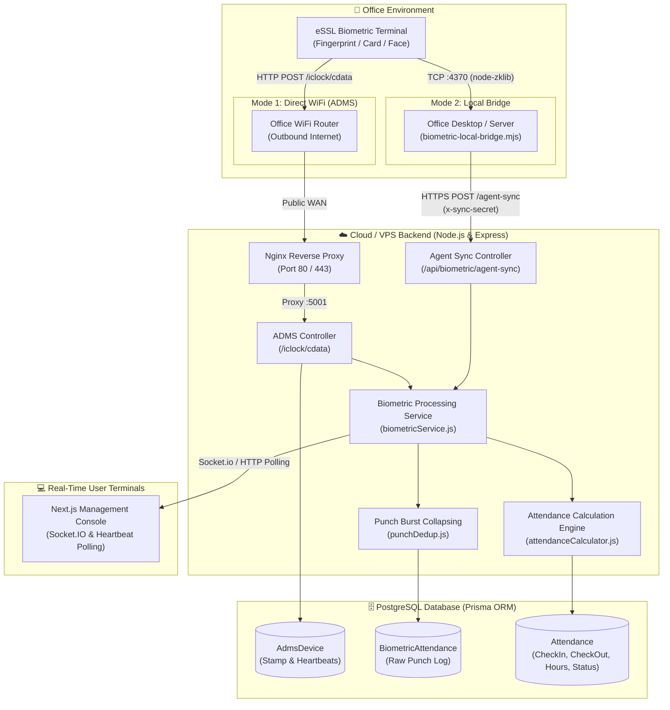
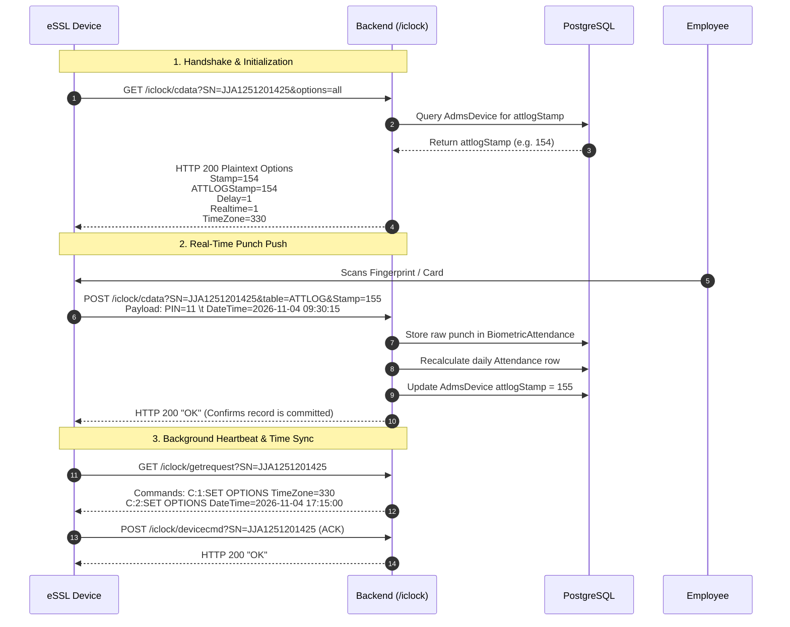
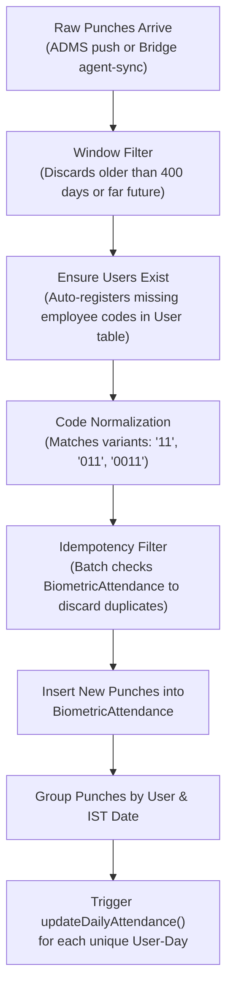

# ⏱️ eSSL Biometric Integration: System Architecture & Workflow

A comprehensive technical guide to how **eSSL / ZKTeco biometric attendance devices** are integrated, synchronized, and processed within the **Tectra Hub (Attendance ERP)** ecosystem.

---

## 📌 Table of Contents
1. [Overview & Device Fundamentals](#1-overview--device-fundamentals)
2. [Dual Architecture Modes](#2-dual-architecture-modes)
3. [Architecture Diagrams](#3-architecture-diagrams)
4. [Mode 1: Cloud-Native ADMS Direct WiFi Push (No Laptop Needed)](#4-mode-1-cloud-native-adms-direct-wifi-push-no-laptop-needed)
5. [Mode 2: Local Office LAN Bridge (`node-zklib`)](#5-mode-2-local-office-lan-bridge-node-zklib)
6. [Punch Ingestion & Deduplication Pipeline](#6-punch-ingestion--deduplication-pipeline)
7. [Daily Attendance Calculation Engine](#7-daily-attendance-calculation-engine)
8. [Database Schema Reference](#8-database-schema-reference)
9. [Real-Time Live UI Synchronization](#9-real-time-live-ui-synchronization)
10. [Troubleshooting & Operational Commands](#10-troubleshooting--operational-commands)

---

## 1. Overview & Device Fundamentals

**eSSL** is a leading biometric hardware provider whose devices run **ZKTeco firmware protocols**. These biometric terminals scan employee fingerprints, RFID cards, or facial geometry, storing timestamped punch events locally on their onboard EEPROM/Flash storage.

### Core Challenges Solved by This System
- **Network Boundaries**: Office biometric machines often sit inside an internal LAN behind NAT/firewalls without public static IPs.
- **Clock Drift**: Device internal real-time clocks (RTC) often drift or reset to default GMT+5:00 instead of IST (GMT+5:30).
- **Punch Bursts**: Employees often scan their fingers 2–4 times in rapid succession (within 1–30 seconds), risking false check-in/out toggles.
- **Downtime Resilience**: Power outages or internet drops at the office must not lose attendance data; devices or bridges must gracefully backfill missed punches.

---

## 2. Dual Architecture Modes

The Tectra Hub backend natively supports **two operational modes**:

| Feature | Mode 1: Direct WiFi Push (ADMS) *(Recommended)* | Mode 2: Local Office Bridge Agent |
| :--- | :--- | :--- |
| **Requires Laptop/PC?** | ❌ No. Direct device-to-cloud over WiFi. | ✅ Yes. A desktop or mini-PC on the LAN. |
| **Protocol** | HTTP / REST push (`iClock / ADMS` protocol). | Proprietary ZK TCP Socket on port `4370`. |
| **Device Configuration** | Cloud Server / ADMS settings in device menu. | Device static IP assigned in local subnet. |
| **Cloud Deployment** | Self-hosted VPS or VM with open port 80/5001. | Vercel Serverless, VPS, or Docker container. |
| **Network Path** | `eSSL Machine` ➔ `Office WiFi` ➔ `VPS (Nginx/Node)`. | `eSSL Machine` ➔ `LAN Switch` ➔ `Bridge Script` ➔ `HTTPS POST` ➔ `Cloud API`. |

---

## 3. Architecture Diagrams

### High-Level System Flow



---

## 4. Mode 1: Cloud-Native ADMS Direct WiFi Push (No Laptop Needed)

This mode turns the eSSL machine into an autonomous IoT client. The device pushes attendance records over HTTP directly to the backend server.

### 4.1 Device Menu Configuration
In the eSSL physical terminal:
1. Go to **Menu** ➔ **Comm.** (Communication) ➔ **Cloud Server Setting** (or **ADMS / Web Server**).
2. Set parameters:
   - **Server Mode**: `ADMS`
   - **Enable Domain Name**: `ON` (or `OFF` if pointing directly to server IP)
   - **Server Address**: `hrms.tectratechnologies.com` (or VPS IP `157.173.218.57`)
   - **Server Port**: `80` (or `5001`)
   - **Enable Proxy Server**: `OFF`
3. Save, restart device, and ensure WiFi is connected.

### 4.2 The ADMS Protocol Communication Cycle
The eSSL device talks to endpoints mounted at `/iclock/` in Express:



### 4.3 Key Handlers in `backend/src/controllers/adms.js`
- **`handleCdataGet` (`GET /iclock/cdata`)**:
  - Validates `SN` (Device Serial Number).
  - Fetches the saved `attlogStamp` from the database.
  - Automatically enqueues a clock synchronization command (`enqueueClockSync`).
  - Replies with config strings (`TimeZone=330` specifies IST in minutes; 330 mins = 5h 30m).
- **`handleCdataPost` (`POST /iclock/cdata`)**:
  - Parses incoming punch text lines (tab-delimited or `PIN=... DateTime=...`).
  - Converts IST wall-clock digits into UTC ISO timestamps.
  - Hands records over to `biometricService.processSync()`.
  - Replies with `OK` only when records are stored. If the server fails, it replies `ERROR (500)`, causing the device to retain the punch and retry later.
- **`handleGetRequest` (`GET /iclock/getrequest`)**:
  - Delivers pending administrative commands (such as remote clock adjustment) to the device.

### 4.4 Nginx Reverse Proxy Configuration
eSSL devices generally make unencrypted HTTP calls (or struggle with HTTPS certificates). Nginx intercepts `/iclock/` on **HTTP Port 80** to prevent `301 Moved Permanently` redirects that break the device:

```nginx
location ^~ /iclock/ {
    proxy_pass http://127.0.0.1:5001/iclock/;
    proxy_http_version 1.1;
    proxy_set_header Host $host;
    proxy_set_header X-Real-IP $remote_addr;
    proxy_set_header X-Forwarded-For $proxy_add_x_forwarded_for;
    proxy_set_header X-Forwarded-Proto $scheme;
}
```

---

## 5. Mode 2: Local Office LAN Bridge (`node-zklib`)

When the cloud backend is hosted on serverless platforms (e.g. Vercel) where direct inbound TCP or stateful connections cannot be received, the **Local Bridge Agent** is deployed inside the office LAN.

### 5.1 Architecture of `backend/scripts/biometric-local-bridge.mjs`
The bridge script runs continuously as a daemon (e.g. using PM2) on an in-office machine:

1. **Persistent State Checkpoint (`.biometric-sync-state.json`)**:
   ```json
   {
     "initialImportDone": true,
     "lastSyncedTimestamp": "2026-11-04T04:15:22.000Z"
   }
   ```
   - On the first boot, it imports the configured historical window (`SYNC_BACK_DAYS=30`).
   - It sets a high-water mark timestamp (`lastSyncedTimestamp`).
   - Subsequent runs only pull records newer than this timestamp minus a 120-second safety overlap.

2. **Two-Phase Socket Lifecycle**:
   - `node-zklib` has an internal quirk where batch calls (`getUsers()`, `getAttendances()`) leak data listeners on the TCP socket, which blocks subsequent real-time event listeners.
   - The bridge solves this using two clean socket phases:
     - **Phase 1 (Transient Socket)**: Connects to `192.168.68.60:4370`, fetches user catalog and runs safety sweep, then safely disconnects.
     - **Phase 2 (Clean Live Socket)**: Opens a fresh TCP socket, registers `zkInstance.getRealTimeLogs()`, and holds it open to capture scans the instant an employee punches.

3. **Cloud Forwarding**:
   - When a punch occurs, the bridge immediately sends an authenticated HTTP request:
     - **Endpoint**: `POST /api/biometric/agent-sync`
     - **Header**: `x-sync-secret: <BIOMETRIC_SYNC_SECRET>`
     - **Payload**:
       ```json
       {
         "records": [
           {
             "employeeCode": "11",
             "employeeName": "Saranya M",
             "timestamp": "2026-11-04T04:00:15.000Z"
           }
         ]
       }
       ```
   - On receipt of HTTP 200, it advances the local checkpoint.
4. **Safety Sweep**: Every 5 minutes, it briefly cycles the connection to re-read the device attendance log to guarantee zero missed punches during network blips.

---

## 6. Punch Ingestion & Deduplication Pipeline

When punch records arrive at `biometricService.processSync()`, they undergo a multi-stage validation and preparation pipeline:



### 1. Code Variant Normalization
Different firmware builds format IDs with varying leading zeroes (e.g. employee 11 might appear as `11`, `011`, or `0011`). The resolver maps all variants to the canonical employee record in PostgreSQL.

### 2. Auto-Creation of Missing Employees
If a new staff member is registered on the biometric terminal before HR inputs them into HRMS:
- The system automatically creates a placeholder user record (`User`).
- Assigns default email: `<employeeCode>@essl.local`.
- Assigns default temporary password hash (`Password@123`) and sets `needsPasswordChange: true`.
- Prevents punches from being rejected or discarded.

### 3. Duplicate Prevention & Burst Collapsing
- **At Ingestion**: Punches with identical `(userId, timestamp)` are skipped via an in-memory signature set and batch database query.
- **At Calculation (`punchDedup.js`)**: `collapsePunchBursts` groups consecutive punches each within 2 minutes of the one before into a single logical punch (retries can be up to ~90s apart). This prevents double-taps at the turnstile from flipping an "IN" punch into an instant "OUT".

---

## 7. Daily Attendance Calculation Engine

Implemented across `biometricService.js` and `utils/attendanceCalculator.js`:

### 7.1 IST Day Framing
Attendance is calculated using **Asia/Kolkata (IST)** day boundaries:
- `istStart`: `YYYY-MM-DDT00:00:00.000+05:30`
- `istEnd`: `YYYY-MM-DDT23:59:59.999+05:30`

### 7.2 Shift Allocation
- **Shift A**: First punch at or before `09:45 AM IST`.
- **Shift B**: First punch after `09:45 AM IST` (Standard: 10:00 AM – 07:00 PM IST).

### 7.3 Working Hours & Punch Pairing
1. **Multi-Punch Days (> 2 punches)**:
   Punches are sorted chronologically and paired as `(In1, Out1), (In2, Out2)`. The sum of all intervals yields net worked hours. Gaps between sessions represent unpaid breaks.
2. **Single-Session Days (2 punches: First In, Last Out)**:
   - If total presence is **< 8.0 hours**: Gross elapsed time is credited (no lunch penalty for partial/short days).
   - If total presence is **≥ 8.0 hours**: 1 hour standard lunch break (13:00 to 14:00) is deducted.
3. **Live Ongoing Sessions (Odd punch count during current workday)**:
   - If an employee has punched in this morning and has not punched out yet:
     - `isOngoing` = `true`.
     - `checkIn` is set to the first punch.
     - `checkOut` remains `null`.
     - Status is marked as **`ON-SITE`**.
     - Live working hours accumulate up to the current wall-clock time.

### 7.4 Status Determination Matrix

| Worked Hours | Ongoing? | Day Type / Context | Final Status in DB |
| :--- | :--- | :--- | :--- |
| **≥ 7.50 hrs** | No | Normal Weekday | `PRESENT` |
| **< 7.50 hrs** (> 0.1 hr) | No | Normal Weekday | `SHORT DAY` |
| **≤ 0.10 hr** (or 0 punches) | No | Approved WFH or Hybrid Schedule | `PRESENT_WFH` |
| **≤ 0.10 hr** (or 0 punches) | No | Approved Leave (Sick/Casual/Earned) | `SL` / `CL` / `PL` / `ON_LEAVE` |
| **≤ 0.10 hr** (or 0 punches) | No | No leave / No WFH | `ABSENT` |
| **Any Hours** | Yes | Current Day | `ON-SITE` |
| **> 0.00 hrs** | Any | Saturday | `OVERTIME_SATURDAY` |
| **> 0.00 hrs** | Any | Sunday | `OVERTIME_SUNDAY` |

---

## 8. Database Schema Reference

The core biometric tables in `backend/prisma/schema.prisma`:

### `BiometricAttendance` (Immutable Raw Punch Stream)
```prisma
model BiometricAttendance {
  id               String             @id @default(uuid())
  userId           String
  employeeCode     String
  timestamp        DateTime           // UTC timestamp of the punch
  deviceIP         String?            // "ADMS-WIFI-JJA1251201425" or "192.168.68.60"
  syncLogId        String?
  createdAt        DateTime           @default(now())
  user             User               @relation(fields: [userId], references: [id], onDelete: Cascade)

  @@index([userId, timestamp])
  @@index([createdAt])
}
```

### `AdmsDevice` (Device Registry & Push Checkpoints)
```prisma
model AdmsDevice {
  serialNumber String    @id          // Device serial number (e.g. JJA1251201425)
  lastSeenAt   DateTime  @default(now())
  lastPushAt   DateTime?
  attlogStamp  Int       @default(0)  // High-water mark upload position
  lastIp       String?
}
```

### `Attendance` (Daily Aggregated Rollup)
```prisma
model Attendance {
  id            String    @id @default(uuid())
  userId        String
  date          DateTime  @db.Date    // Midnight UTC representation of IST date
  checkIn       DateTime?             // Timestamp of earliest punch of the day
  checkOut      DateTime?             // Timestamp of latest punch (null if ongoing)
  status        String                // PRESENT, SHORT DAY, ON-SITE, ABSENT, etc.
  workingHours  Float     @default(0) // Net billable working hours
  breakTime     Float     @default(0) // Lunch / break deduction
  deficit       Float     @default(0) // Hours short of 8.0h standard
  shiftType     String?               // "A" or "B"
  user          User      @relation(fields: [userId], references: [id], onDelete: Cascade)

  @@unique([userId, date])
}
```

---

## 9. Real-Time Live UI Synchronization

To provide instant UI updates when an employee punches at the physical terminal:

1. **WebSocket (`Socket.io`)**:
   - The backend emits:
     ```javascript
     io.emit('biometricSyncUpdate', {
       status: 'SUCCESS',
       total: result.totalProcessed,
       success: result.successCount,
       timestamp: new Date().toISOString()
     });
     ```
   - Connected admin dashboards refresh metrics, active employee counters, and table views immediately.

2. **Ultra-Lightweight Change Marker Polling (`GET /api/biometric/heartbeat`)**:
   - For environments where persistent WebSockets are not feasible (e.g., Vercel serverless):
   - Browsers poll `/api/biometric/heartbeat` every few seconds.
   - Endpoint reads a single indexed row and returns:
     ```json
     {
       "marker": "2026-11-04T04:15:22.000Z:c2e17d98-...",
       "lastPunchAt": "2026-11-04T04:15:20.000Z",
       "lastSyncedAt": "2026-11-04T04:15:22.000Z"
     }
     ```
   - The frontend only triggers an expensive full data re-fetch when `marker` changes.

---

## 10. Troubleshooting & Operational Commands

### 10.1 How to Verify Live ADMS Communication
Test whether the server is responding to device initialization requests:
```bash
curl -i "http://hrms.tectratechnologies.com/iclock/cdata?SN=JJA1251201425&options=all"
```
*Expected response:*
```http
HTTP/1.1 200 OK
Content-Type: text/plain; charset=utf-8

GET OPTION FROM: JJA1251201425
Stamp=...
ATTLOGStamp=...
TimeZone=330
Realtime=1
...
```

### 10.2 How to Force the Device to Re-Upload All Punches
If punches were missed or database was re-seeded, reset the device stamp to `0`:

**Option A: Via API**
```bash
curl -X POST "http://hrms.tectratechnologies.com/api/biometric/adms/reset-stamp" \
     -H "Content-Type: application/json" \
     -d '{"serialNumber": "JJA1251201425"}'
```

**Option B: Direct Node script on VPS**
```bash
# In backend directory:
node -e "
import prisma from './src/config/prisma.js';
await prisma.admsDevice.updateMany({ data: { attlogStamp: 0, lastPushAt: null } });
console.log('Reset complete');
await prisma.\$disconnect();
"
```
*After resetting the stamp, restart or reboot the eSSL device. On the next handshake, it will re-upload historical logs.*

### 10.3 Device Clock 30-Minute Offset Issue
- **Symptom**: Punches are stored exactly 30 minutes behind IST (e.g. punch at 10:00 AM appears as 09:30 AM).
- **Cause**: Device parsed `TimeZone=5:30` as GMT+5 instead of GMT+5:30.
- **Fix**: The backend protocol handler explicitly returns `TimeZone=330` (minutes offset) and commands `SET OPTIONS TimeZone=330`.

### 10.4 Inspecting Live Backend Logs on VPS
```bash
pm2 logs attendance-backend --lines 100 | grep -E "ADMS|BiometricService"
```
Look for:
- `[ADMS] Init config for SN:JJA1251201425 stamp=...`
- `[ADMS] SN:JJA1251201425 uploaded 1 ATTLOG record(s)`
- `[BiometricService] Inserting 1 new punch record(s).`
- `[BiometricService] Updating daily attendance for 1 unique user-days...`

